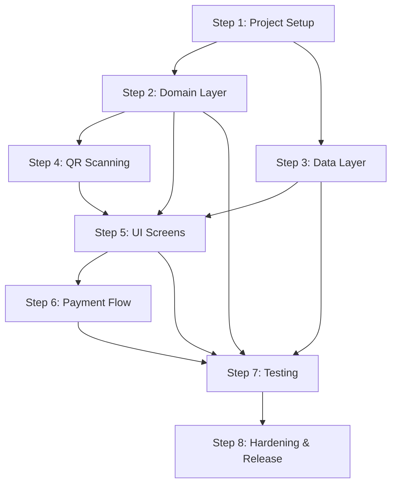

# UPI QR Scan-and-Pay — Implementation Plan

> Derived from [architecutre_report.md](file:///d:/Projects/MyApplication/architecutre_report.md)

---

## Step 1 — Project Bootstrapping & Configuration

Set up the Android project skeleton, dependency graph, and build configuration before writing any feature code.

### 1.1 Create the Android project
- Create a new Android project with **Kotlin** and **Jetpack Compose** template (Empty Compose Activity).
- Set **`minSdk = 26`**, **`targetSdk`** to the latest SDK required by Play.
- Package name: choose a reverse-domain name (e.g. `com.yourname.upipay`).

### 1.2 Configure Gradle dependencies
Add all required libraries to `build.gradle.kts` (app-level):

| Category | Libraries |
|---|---|
| Compose & Material 3 | `androidx.compose.material3`, `androidx.navigation.compose` |
| CameraX | `camera-core`, `camera-camera2`, `camera-lifecycle`, `camera-view` |
| ML Kit Barcode | `com.google.mlkit:barcode-scanning` (bundled) |
| Hilt | `hilt-android`, `hilt-compiler`, `hilt-navigation-compose` |
| Room | `room-runtime`, `room-ktx`, `room-compiler` |
| DataStore | `androidx.datastore:datastore-preferences` |
| Testing | `junit`, `turbine`, `compose-ui-test`, `espresso-intents`, `hilt-testing` |

### 1.3 Create the package structure
```
app/src/main/java/com/<pkg>/
  ui/
    scan/
    confirm/
    amount/
    picker/
    result/
    history/
    navigation/
    theme/
  domain/
    model/
    usecase/
  data/
    upi/
    db/
    prefs/
  di/
```

### 1.4 Set up the app theme ✅

#### 1.4.1 Create `Color.kt` ✅
- File: `ui/theme/Color.kt`
- Defined semantic `ColorTokens` data class with 15 tokens.
- Defined `DarkColorTokens` (primary) and `LightColorTokens` with exact HSL trailing comments and contrast verifications.


#### 1.4.2 Create `Type.kt` ✅

- **1.4.2.1 Add Google Fonts dependency** ✅
  - Added `androidx-ui-text-google-fonts` to `gradle/libs.versions.toml`.
  - Added `implementation(libs.androidx.ui.text.google.fonts)` to `app/build.gradle.kts`.

- **1.4.2.2 Configure GoogleFont Provider & Outfit FontFamily** ✅
  - Created `font_certs.xml` with Google Play Services certificates.
  - Configured `GoogleFont.Provider` pointing to `com.google.android.gms.fonts`.
  - Defined `OutfitFontFamily` with weights 400 (Normal), 500 (Medium), 600 (SemiBold), 700 (Bold).

- **1.4.2.3 Define Material 3 Typography** ✅
  - Configured complete Material 3 `Typography` scale (`displayLarge` through `labelSmall`) with the Outfit font family.

- **1.4.2.4 Verify build** ✅
  - Verified compilation via `:app:compileDebugKotlin` (BUILD SUCCESSFUL).


#### 1.4.3 Create `Shape.kt` ✅

- **1.4.3.1 Define corner radius tokens & semantics** ✅
  - Mapped corner radii to Material 3 UI roles:
    - `extraSmall = 4.dp` (badges, chips)
    - `small = 8.dp` (buttons, input fields)
    - `medium = 16.dp` (cards, dialogs, keypad surfaces)
    - `large = 24.dp` (bottom sheets, primary action containers)
    - `extraLarge = 32.dp` (modal bottom sheet corners, prominent modals)

- **1.4.3.2 Implement `Shape.kt`** ✅
  - Created `ui/theme/Shape.kt` defining `AppShapes` (and `Shapes` alias) using `RoundedCornerShape`.

- **1.4.3.3 Verify compilation** ✅
  - Verified `:app:compileDebugKotlin` compiles cleanly with zero errors (`BUILD SUCCESSFUL`).


#### 1.4.4 Create `Theme.kt` ✅

- **1.4.4.1 Map `ColorTokens` to Material 3 `ColorScheme`** ✅
  - Mapped `DarkColorTokens` to full `darkColorScheme`.
  - Mapped `LightColorTokens` to full `lightColorScheme`.
  - Provided `LocalColorTokens` to expose custom tokens (`success`, `warning`, `surfaceRaised`, `onSurfaceMuted`).

- **1.4.4.2 Implement `AurumTheme` Composable** ✅
  - Configured dynamic color on API 31+ (`dynamicDarkColorScheme` / `dynamicLightColorScheme`).
  - Added fallback to static `ColorTokens` scheme.
  - Wired `AppTypography` (from `Type.kt`) and `AppShapes` (from `Shape.kt`) into `MaterialTheme`.
  - Provided helper `AurumTheme.colors` accessor.

- **1.4.4.3 Ensure Edge-to-Edge display in `MainActivity.kt`** ✅
  - Configured `WindowCompat.setDecorFitsSystemWindows(window, false)` and `enableEdgeToEdge()`.

- **1.4.4.4 Verify compilation & build** ✅
  - Verified `:app:compileDebugKotlin` and full `:app:assembleDebug` compile and package cleanly (`BUILD SUCCESSFUL in 1m 5s`).


### 1.5 Configure the AndroidManifest ✅

- **1.5.1 Permissions & Features** ✅
  - Added `<uses-permission android:name="android.permission.CAMERA" />`.
  - Added `<uses-feature android:name="android.hardware.camera" android:required="false" />`.

- **1.5.2 Package Visibility Queries for UPI Apps** ✅
  - Added `<queries>` block with `intent` specifying `android.intent.action.VIEW` for `upi://pay`.

- **1.5.3 Security Hardening: Disable Data Backup** ✅
  - Set `android:allowBackup="false"` on `<application>` tag.

- **1.5.4 Application Class & Hilt Setup** ✅
  - Created `AurumApplication.kt` annotated with `@HiltAndroidApp`.
  - Registered `android:name=".AurumApplication"` in `AndroidManifest.xml`.
  - Annotated `MainActivity` with `@AndroidEntryPoint`.

- **1.5.5 Final Acceptance Verification** ✅
  - Verified project compiles, builds debug APK, and runs unit tests (`BUILD SUCCESSFUL in 1m 16s`, 50 actionable tasks).
  - All dependencies resolve without conflicts.

### ✅ Step 1 Acceptance Complete
- [x] Project compiles and runs Compose screen with AurumTheme.
- [x] All dependencies resolve without conflicts.
- [x] Debug APK packaged and unit tests passed.


---

## Step 2 — Domain Layer (Pure Kotlin, No Android)

Build the business logic first so it can be unit-tested on the JVM without Robolectric.

### 2.1 Define domain models
Create the following data classes/sealed interfaces in `domain/model/`:

| File | Contents |
|---|---|
| `UpiPayload.kt` | `data class UpiPayload(vpa, payeeName, amount: BigDecimal?, note, txnRef, rawUri)` |
| `UpiApp.kt` | `data class UpiApp(packageName, label)` (icon resolved in UI layer) |
| `PaymentOutcome.kt` | `sealed interface PaymentOutcome { Success, Pending, Failed, Unconfirmed }` |
| `Transaction.kt` | `data class Transaction(id, vpa, payeeName, amountPaise, note, …, status, createdAt, updatedAt)` |
| `TransactionStatus.kt` | `enum: INITIATED, SUCCESS, PENDING, FAILED, UNCONFIRMED, USER_CONFIRMED_PAID` |
| `ScanError.kt` | `sealed interface ScanError { NotUpiQr, InvalidVpa, UnsupportedCurrency, InvalidAmount }` |

### 2.2 Implement `ParseUpiQr` use case
- File: `domain/usecase/ParseUpiQr.kt`
- Parse the raw QR string into a `UpiPayload`.
- Validation rules:
  - Scheme must be `upi`, host must be `pay`.
  - `pa` (VPA) is required and must match `^[a-zA-Z0-9._-]{2,256}@[a-zA-Z]{2,64}$`.
  - `cu` must be `INR` or absent.
  - `am` must be a positive number with ≤ 2 decimal places (if present).
  - Strip control characters, cap field lengths.
- Return `Result<UpiPayload>` (success or typed failure).

> [!TIP]
> Use `java.net.URI` instead of `android.net.Uri` inside the domain layer so the parser is testable on the JVM without Robolectric.

### 2.3 Implement `ValidateAmount` use case
- File: `domain/usecase/ValidateAmount.kt`
- Accepts a user-typed string, returns a `BigDecimal` or a validation error.
- Rules: positive, ≤ 2 decimals, below a configurable sanity cap (e.g. ₹1,00,000).

### 2.4 Implement `BuildUpiUri` use case
- File: `domain/usecase/BuildUpiUri.kt`
- If the QR already had an amount → return the raw URI unchanged (preserves merchant signature).
- Otherwise → append `am` and `cu=INR` to the raw URI.

### 2.5 Implement `InterpretPaymentResult` use case
- File: `domain/usecase/InterpretResult.kt`
- Parse the response `Intent` extras and the `response` query string.
- Map `Status` (case-insensitive) to `PaymentOutcome`.

### 2.6 Define repository interfaces
- `domain/usecase/GetInstalledUpiApps.kt` — interface/contract for fetching installed UPI apps.
- Repository interfaces (can live in domain or data boundary):
  - `UpiAppRepository` — `fun getInstalledApps(): List<UpiApp>`
  - `TransactionRepository` — CRUD for transactions.
  - `PreferencesRepository` — last-used app, settings.

### ✅ Acceptance
- All use cases have passing JVM unit tests (no Android emulator needed).
- Parser tested with: valid QR, missing `pa`, bad VPA, bad amount, non-INR, URL-encoded characters, extra params, edge-case strings.

---

## Step 3 — Data Layer (Room, DataStore, PackageManager)

Wire up persistence and platform access behind the repository interfaces.

### 3.1 Room database setup
- `data/db/TransactionEntity.kt` — Room entity mapping to the `Transaction` domain model.
  - `id` (UUID String, primary key), `vpa`, `payeeName`, `amountPaise` (Long), `note`, `qrTxnRef`, `upiTxnId`, `appPackage`, `status` (enum stored as String), `createdAt`, `updatedAt`.
- `data/db/TransactionDao.kt` — DAO with:
  - `insertTransaction(entity)`
  - `updateStatus(id, status, upiTxnId?, updatedAt)`
  - `getAllTransactions(): Flow<List<TransactionEntity>>` (ordered by `createdAt DESC`)
  - `getInitiatedTransactions(): List<TransactionEntity>` (for reconciliation)
  - `deleteAll()`
- `data/db/AppDatabase.kt` — `@Database` annotated abstract class with version 1.

### 3.2 TransactionRepository implementation
- `data/db/TransactionRepositoryImpl.kt`
- Maps between `TransactionEntity` ↔ `Transaction` domain model.
- Implements the `TransactionRepository` interface from the domain layer.

### 3.3 DataStore preferences
- `data/prefs/PreferencesRepositoryImpl.kt`
- Keys: `LAST_USED_UPI_APP` (String — package name).
- Implements `PreferencesRepository`.

### 3.4 UPI app repository
- `data/upi/UpiAppRepositoryImpl.kt`
- Uses `PackageManager.queryIntentActivities()` with a probe `upi://pay` intent.
- Maps `ResolveInfo` → `UpiApp` domain model.
- Sorts results: last-used app first, then alphabetical.

### 3.5 Hilt DI modules
- `di/DatabaseModule.kt` — provides `AppDatabase`, `TransactionDao`.
- `di/RepositoryModule.kt` — binds `*Impl` to interfaces.
- `di/DataStoreModule.kt` — provides the `DataStore<Preferences>` singleton.

### ✅ Acceptance
- Room database creates, migrates, and round-trips entities correctly.
- DataStore reads/writes the last-used app.
- `UpiAppRepositoryImpl` returns a list on a real device.

---

## Step 4 — QR Scanning (CameraX + ML Kit)

### 4.1 Camera permission flow
- `ui/scan/CameraPermissionHandler.kt` (or inline in ScanScreen)
- Request `CAMERA` permission using the Accompanist Permissions API or the `rememberLauncherForActivityResult` pattern.
- States: not requested → rationale → granted / permanently denied.
- If denied: show explanation + button to open App Settings; offer gallery import as fallback.

### 4.2 CameraX preview composable
- `ui/scan/CameraPreview.kt`
- Bind `Preview` and `ImageAnalysis` use cases to the lifecycle.
- `ImageAnalysis` strategy: `STRATEGY_KEEP_ONLY_LATEST` (back-pressure).
- Set target resolution to ~1280×720 for performance.

### 4.3 QR code analyzer
- `ui/scan/QrCodeAnalyzer.kt` — implements `ImageAnalysis.Analyzer`.
- Configure ML Kit `BarcodeScannerOptions` with `FORMAT_QR_CODE` only.
- On each frame:
  1. Convert `ImageProxy` to `InputImage`.
  2. Feed to ML Kit scanner.
  3. For each detected barcode, check if raw value starts with `upi://pay`.
  4. If valid UPI QR found and not already locked → invoke callback.
- Use an `AtomicBoolean` to lock after the first valid detection (prevent duplicate navigations).

### 4.4 Scanner UX extras
- **Torch toggle** — `camera.cameraControl.enableTorch(true/false)`.
- **Tap-to-focus** — `PreviewView.setOnTouchListener` with `MeteringPointFactory`.
- **Pinch-to-zoom** — `ScaleGestureDetector` updating `camera.cameraControl.setZoomRatio`.
- **Haptic feedback** — `HapticFeedbackType.LongPress` on successful scan.
- **Viewfinder overlay** — draw a semi-transparent overlay with a cut-out square using Canvas.

### 4.5 Gallery import
- Use Photo Picker (`PickVisualMedia`) to let the user select a QR image.
- Decode the selected image with ML Kit `BarcodeScanning.getClient().process(InputImage.fromFilePath(...))`.

### ✅ Acceptance
- Camera preview renders smoothly.
- QR codes are detected within ~500ms in normal lighting.
- Torch, tap-to-focus, and pinch-to-zoom work.
- Gallery import decodes a QR from a saved image.
- Non-UPI QR codes are ignored with a brief toast.

---

## Step 5 — UI Screens (Jetpack Compose + Navigation)

### 5.1 Navigation graph
- `ui/navigation/AppNavigation.kt`
- Define routes: `scan`, `confirm/{payload}`, `amount/{payload}`, `result/{txnId}`, `history`.
- Use `NavHost` with Compose Navigation.
- Consider a shared `PaymentFlowViewModel` scoped to the nav graph for cross-screen state.

### 5.2 ScanScreen
- `ui/scan/ScanScreen.kt` + `ScanViewModel.kt`
- Full-screen camera preview with viewfinder overlay.
- Top bar: torch toggle button, gallery import button.
- On QR detected → navigate to Confirm or Amount screen.
- Handle permission states inline.

### 5.3 ConfirmPayeeScreen
- `ui/confirm/ConfirmPayeeScreen.kt`
- Display: payee name (large), VPA (monospaced), amount (if present, read-only).
- Warn if payee name is empty or VPA handle looks unusual.
- "Continue" button → navigate to Amount (if no amount) or AppPicker (if amount present).

### 5.4 AmountScreen
- `ui/amount/AmountScreen.kt` + `AmountViewModel.kt`
- Custom numeric keypad (large touch targets).
- Live formatting with Indian locale (₹ symbol, lakh/crore separators).
- Inline validation error text below the amount field.
- "Pay ₹X" button → navigate to AppPicker.

### 5.5 UpiAppPickerSheet
- `ui/picker/UpiAppPickerSheet.kt`
- Modal bottom sheet listing installed UPI apps (icon + label).
- Last-used app pre-selected / shown first.
- Empty state: "No UPI app installed" with a Play Store link.
- On app tap → save preference, create pending transaction, launch payment.

### 5.6 ResultScreen
- `ui/result/ResultScreen.kt`
- Four visual states:

| State | Visual |
|---|---|
| **Success** | Green checkmark animation, "Reported by your UPI app" disclaimer |
| **Pending** | Amber clock icon, "Check your UPI app for status" |
| **Failed** | Red X, response code detail, "Retry" button |
| **Unconfirmed** | Gray question mark, "Did the payment go through?" toggle for manual confirmation |

- "Scan another" button → navigate back to `scan`.
- "View history" link.

### 5.7 HistoryScreen
- `ui/history/HistoryScreen.kt` + `HistoryViewModel.kt`
- Lazy list of past transactions (payee, amount, status, date).
- Status chip with color coding.
- "Clear history" action in the top bar.

### 5.8 Shared UI state
- `ui/scan/PayUiState.kt` — sealed interface as described in the architecture report.
- The `PaymentFlowViewModel` (or per-screen VMs) exposes `StateFlow<PayUiState>`.

### ✅ Acceptance
- All screens render correctly on multiple screen sizes.
- Navigation transitions are smooth.
- Amount formatting displays ₹1,00,000 correctly.
- App picker shows real installed UPI apps.
- Result screen shows all 4 outcome states.

---

## Step 6 — Payment Launch & Result Handling

### 6.1 Activity Result contract
- Register an `ActivityResultLauncher<Intent>` using `StartActivityForResult` contract.
- This should be set up in the hosting `Activity` or `ComposableActivity` and shared via the ViewModel / a callback.

### 6.2 Build and launch the payment intent
- In the ViewModel (or a dedicated `PaymentLauncher` class):
  1. Build the URI using `BuildUpiUri` use case.
  2. Create `Intent(ACTION_VIEW, uri).setPackage(selectedApp.packageName)`.
  3. **Before launching**: save a `Transaction` with status `INITIATED` to Room (generates UUID).
  4. Launch via the `ActivityResultLauncher`.
  5. Catch `ActivityNotFoundException` → show error, return to picker.

### 6.3 Handle the result callback
- In the `onActivityResult` callback:
  1. Call `InterpretPaymentResult` use case with the returned `Intent`.
  2. Update the Room transaction with the resolved status and `txnId`.
  3. Navigate to `ResultScreen`.

### 6.4 Process-death reconciliation
- On app cold start (in `Application.onCreate` or a `ViewModel.init`):
  1. Query Room for transactions with status `INITIATED`.
  2. If found, show a reconciliation prompt: "A payment was in progress. Did it complete?"
  3. Let the user mark it as paid or failed.

### 6.5 Double-tap prevention
- Debounce the "Pay" / app-select button (disable it for 1–2 seconds after first tap).
- Prevent re-navigation while `AwaitingResult` state is active.

### ✅ Acceptance
- Payment intent opens the correct UPI app.
- Returning from the UPI app correctly shows Success / Pending / Failed / Unconfirmed.
- Killing the app during payment → reconciliation prompt on next open.
- Double tapping the pay button does not launch two intents.

---

## Step 7 — Testing

### 7.1 Unit tests (JVM)
- **Parser tests** (`ParseUpiQrTest.kt`):
  - Valid standard QR, valid merchant QR with all fields.
  - Missing `pa` → failure.
  - Invalid VPA format → failure.
  - Invalid amount (negative, too many decimals, non-numeric) → failure.
  - Non-INR currency → failure.
  - URL-encoded characters in `pn` and `tn`.
  - Extra/unknown parameters → still succeeds.
  - Empty string, random text, HTTP URLs → failure.
- **Amount validation tests** (`ValidateAmountTest.kt`):
  - Valid amounts, zero, negative, > cap, > 2 decimals, non-numeric.
- **URI builder tests** (`BuildUpiUriTest.kt`):
  - QR with amount → raw URI unchanged.
  - QR without amount → `am` and `cu` appended.
- **Result interpreter tests** (`InterpretResultTest.kt`):
  - SUCCESS, FAILURE, SUBMITTED, PENDING, empty intent, null data, mixed-case keys.

### 7.2 ViewModel tests
- Use **Turbine** to collect `StateFlow` emissions.
- Test state transitions: `Scanning` → `Confirm` → `EnterAmount` → `ChooseApp` → `AwaitingResult` → `Result`.
- Use fake repositories injected via Hilt testing.

### 7.3 UI / Compose tests
- **ScanScreen**: permission prompt renders, camera preview placeholder.
- **ConfirmScreen**: payee name and VPA displayed correctly.
- **AmountScreen**: keypad input updates display, validation error shown.
- **AppPickerSheet**: list of apps renders, tap fires callback.
- **ResultScreen**: correct icon/color for each outcome.

### 7.4 Integration / Intent tests
- **Espresso-Intents**: stub the UPI intent to return canned results (SUCCESS, FAILURE, SUBMITTED, empty, cancelled) and verify the result screen displays correctly.

### 7.5 Manual device testing
- Test on real devices with: PhonePe, Google Pay, Paytm, BHIM.
- Test on Android 11 (package visibility), 13, and latest.
- Use small amounts to a second personal account.
- Test with printed QR codes, on-screen QR codes, low light, glare, tilted angles.

### ✅ Acceptance
- ≥ 90% line coverage on the domain layer.
- All ViewModel state transitions covered.
- Espresso intent stubs cover all 4 outcome states.
- No crashes on tested devices.

---

## Step 8 — Security Hardening, Polish & Release

### 8.1 Security hardening
- [ ] `android:allowBackup="false"` in manifest.
- [ ] No payment details in `Log.*` calls (strip in release builds via R8/ProGuard).
- [ ] `FLAG_SECURE` on payment confirmation and result screens (optional).
- [ ] Enable R8 full mode with `minifyEnabled true` and `shrinkResources true`.
- [ ] Review all exported components — nothing should be exported that doesn't need to be.

### 8.2 Accessibility
- Content descriptions on all icons and images.
- Touch targets ≥ 48dp.
- Screen reader testing with TalkBack.
- Sufficient color contrast ratios (WCAG AA).

### 8.3 Localization
- Extract all strings to `strings.xml`.
- Add Hindi (`values-hi/`) and other regional language translations.
- RTL layout testing.

### 8.4 Process-death & config-change resilience
- Ensure `SavedStateHandle` or Room-backed state survives:
  - Screen rotation.
  - Background process kill.
  - Split-screen transitions.

### 8.5 Play Store preparation
- Write the Play Store listing (title, description, screenshots).
- Create a privacy policy (hosted URL) — must cover what data is stored locally.
- Complete the **Financial Features declaration** and **Data Safety** form.
- Prepare a signed release APK/AAB.

### 8.6 Beta release
- Publish to a closed testing track.
- Gather feedback from beta testers.
- Monitor crash reports (Firebase Crashlytics or Play Console).

### ✅ Acceptance
- No sensitive data in logs.
- App passes TalkBack navigation.
- Hindi strings render correctly.
- App survives process death mid-payment.
- Play Store listing is complete and privacy policy is published.

---

## Dependency Graph (Build Order)



> [!IMPORTANT]
> **Steps 2 and 3** can be worked on in parallel after Step 1 is complete. **Step 4** (scanning) and **Step 5** (UI) depend on the domain models from Step 2. **Step 6** (payment flow) wires everything together. **Step 7** (testing) should be done continuously but has a dedicated pass after Step 6. **Step 8** is the final polish before release.

---

## Estimated Timeline

| Step | Effort | Cumulative |
|---|---|---|
| 1 — Project Setup | 1 day | Day 1 |
| 2 — Domain Layer | 2–3 days | Day 3–4 |
| 3 — Data Layer | 2 days | Day 3–4 (parallel with 2) |
| 4 — QR Scanning | 2–3 days | Day 6–7 |
| 5 — UI Screens | 3–4 days | Day 10–11 |
| 6 — Payment Flow | 2–3 days | Day 13–14 |
| 7 — Testing | 3–4 days | Day 17–18 |
| 8 — Hardening & Release | 3–5 days | Day 21–23 |
| **Total** | **~3–4 weeks** | |
